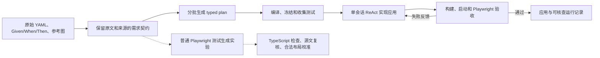

# Lightweight application-builder experiment

Research checked on 2026-11-14. The experiment lives on `experiment/react-lite`.
Run it from the existing repository with its current Python dependencies.

## Observed baseline

The supplied 2026-11-07 Keep log records 60m41s of agent execution and 152
`MODEL CALL` entries. The intervals between call/output markers sum to about
49m44s. This includes provider generation and network waiting.

Stage 06 takes 6m40s and fails after repeated obligation-propagation feedback.
Stage 11 takes 4m03s and fails on the missing upstream contract. Stage 12 then
takes 27m45s, including a second acceptance-generation/review workflow starting
at 16:16:47. Five attempts to read disallowed source files appear in that final
workflow. These observations describe the archived run. Current-branch timing
and costs require a new measurement under matching conditions.

## Framework and strategy comparison

| Approach | Relevant mechanism | Experiment decision |
| --- | --- | --- |
| mini-SWE-agent v2 | Linear conversation, query/action/observation loop, explicit limits and saved trajectory | Use this execution structure and compare complete runs |
| Deep Agents | Filesystem tools, context offloading, configurable middleware and model-specific profiles | Keep as an integration candidate when context management is measured as a bottleneck |
| Deep Agents v0.7 | Shorter base prompting, smaller tool descriptions, opt-in todo middleware | Start with a compact tool contract and a progress string |
| smolagents | Multi-step loop controlled by model outputs, tools or executable code | Use a similarly direct loop with the existing JSON-compatible transport |
| Anthropic long-running app harness | Feature-by-feature implementation, browser evaluation, session handoffs | Borrow feature-level verification; measure orchestration cost before adding roles |

These projects address different benchmarks and models. Their published scores
do not predict ArcBench performance. The current prototype is a small local
implementation of the loop pattern with the repository's transport and scaffold.

Sources, checked directly from the projects' documentation and engineering posts

- [mini-SWE-agent execution loop](https://mini-swe-agent.com/latest/advanced/control_flow/)
- [Deep Agents overview](https://docs.langchain.com/oss/python/deepagents/overview)
- [Deep Agents v0.7, 2026-07-29](https://www.langchain.com/blog/deep-agents-v0-7)
- [Model-specific harness profiles, 2026-04-29](https://www.langchain.com/blog/tuning-deep-agents-different-models)
- [Trace-driven harness improvements, 2026-02-17](https://www.langchain.com/blog/improving-deep-agents-with-harness-engineering)
- [smolagents multi-step execution](https://huggingface.co/docs/smolagents/conceptual_guides/intro_agents)
- [Application-development harness, 2026-03-24](https://www.anthropic.com/research/harness-design-long-running-apps)

## Execution differences

| Concern | Existing compiler | Experimental runner |
| --- | --- | --- |
| Scheduling | Thirteen ordered passes with per-task loops | One ongoing implementation conversation |
| Intermediate contracts | Schema, obligations, API P/Q, UI IR, trigger plans | Source-linked requirement clauses and compact UI declarations |
| Editing | Stage-owned writable scopes and gates | Cross-layer batches of related edits |
| Context | Stage payload, selected files, discovery and feedback | Append action and observation messages |
| Checking | Many stage-specific generation/review/repair gates | A verification action that builds, starts and runs a frozen external suite |
| Failure | Record failed passes and attempt later passes | Return tool failures to the same conversation; propagate transport failures |
| Measurement | Existing stage/model logs | JSONL trajectory and aggregate time/token report |

## Running the prototype

Compile a separate acceptance suite with one model request and check the actual
case inventory using an installed Playwright CLI.

```powershell
python -m infrastructure.react_agent.acceptance INPUT -o TESTS --playwright-cli PLAYWRIGHT_CLI
```

Then run implementation against the frozen suite.

```powershell
python -m infrastructure.react_agent.runner INPUT -o OUTPUT --max-steps 40 --time-budget 900 --acceptance-dir TESTS --playwright-cli PLAYWRIGHT_CLI
```

`INPUT` contains the original `requirements.yaml` and reference materials.
`OUTPUT` is a separate application directory. The runner uses the existing
environment configuration and model credentials. The budget is in seconds.
`--skip-install` supports an application with dependencies already prepared.

The model can list/read files, write whole files, perform unique replacements,
execute argument-list commands and request reference-image analysis. Tools run
from the application directory. Commands execute with the runner's OS permissions,
so an isolated execution environment is needed for untrusted tasks. File-tool
path checks provide application/input boundaries; arbitrary commands have normal
process-level access. Original requirement files are read-only through file tools.

`--browser-channel chrome` selects installed Chrome for local browser checks.
Interrupted runs can continue from their saved conversation with `--resume`.
For an already installed workspace, `--skip-install` avoids repeating installation.
The requirement-source hash is checked before a resumed run publishes artifacts.
The verification action builds the application, starts its real server on a
temporary port with a fresh database, checks health and the root HTML response,
and executes the supplied suite. It stops the owned process tree afterward.
Without a supplied suite the success status is `BUILD_AND_STARTUP_PASSED`, with
`behavior_verified: false`. A passing external suite produces `ACCEPTANCE_PASSED`.
Requirement-level results retain unexecuted cases as `UNVERIFIED`. These metrics
describe the supplied tests' coverage; additional acceptance can still find bugs.

The test runner stops after the first failure by default. The agent can repair
the cause and run the full suite again. A successful run requires all cases to
execute and pass. Expected failures, skipped cases and missing executable cases
cannot produce a passing acceptance result.

Artifacts live in `OUTPUT/.arc/`

- `react-trajectory.jsonl` contains action batches and observations.
- `react-report.json` contains status, elapsed/model/tool time and provider token usage.
- `requirements.json` preserves the original structured input.
- `requirement-contracts.json` indexes clauses, source pointers and UI declarations.
- `react-session.json` checkpoints the conversation for explicit resume.
- `framework-manifest.json` fingerprints framework sources, Git commit/worktree and base instructions.
- `react-instructions.txt` retains the implementation base prompt.
- `verification/` retains raw Playwright reports, server output and failure artifacts.

The input compiler reuses `RequirementTree` and input-material discovery. It
retains parent constraints, scenario clauses, data/environment declarations and
unknown metadata. Its lexical UI index recognizes quoted `role=...` annotations,
templates and directly stated containment. Other natural-language relationships
remain in the original clauses for interpretation. Website defaults govern
underspecified feedback and landmark naming, with explicit requirements taking
precedence. They are project interpretation rules.

Primary-conversation token counts cover successful parsed responses, including
reported cache/reasoning token counts. Reference image analysis has a separate
call counter. Provider compatibility fallbacks, malformed response usage and
image-token totals still need fuller accounting before cost comparisons.

## Initial evidence

These local runs use the same original six-requirement Keep input extracted from
the archived result. The archived baseline ran on the platform. Hardware, network
and cache differences prevent treating the timing ratio as a controlled speedup.

| Run | Elapsed | Primary turns | Image analyses | External result |
| --- | --- | --- | --- | --- |
| Keep v1 | 10m31s | 20 | 4 | 8/11 |
| Keep v2 | 7m34s | 16 | 2 | 9/11 |
| Keep v3 with external repair gate | 10m18s | 17 | 3 | 11/11 |
| Keep v4 with reusable driver and verify action | 4m40s | 10 | 2 | Generated suite 11/11, original external suite 11/11 |
| BookStack Lite v1 | 13m13s | 31 | 3 | 12/12 |
| Keep v6 automatic public entry | 3m46s including test compilation | 8 | 3 | Generated suite 11/11, original external suite 11/11 |

V1 omitted a named status contract. V2 supplied that name on a child element,
leaving Undo outside the status container. V3 used the source-linked containment
information and corrected a misplaced navigation landmark name after the first
external failure. It then passed the same eleven-case suite within the existing
conversation.

Test compilation also needs direct validation. The first generated suite passed
the known-defective V1 application. The next suite incorrectly required literal
visible text for a named navigation landmark. The third suite passed all eleven
cases on a separately verified local control and rejected the three known status
cases on V1. Its single compilation call took about 97 seconds.

A reasoning-disabled test compilation took about 22 seconds, compared with the
roughly 97-second low-reasoning run. Its manifest claimed an executable workspace
test that was absent from the source files. The Playwright collection check
detected this mismatch. This experiment supports validating generated evidence
against actual collected cases before using token/time reductions as improvements.

Artifacts for these experiments are stored under `output/react-experiment/`.
The local control contains an explicit two-line feedback-container correction
and is a test-calibration artifact. It is separate from autonomous generation results.

Keep v6 uses the official DeepSeek endpoint and a per-request output cap of 24,000
tokens in the local budget guard. Its test compilation and collection are included
in the 225.7-second total. The application phase took 148.5 seconds. The preceding
v5 automatic-entry trial stopped on a test-plan format error before generating an
application. The correction clarified declaration target syntax and added one
bounded format correction. The new frozen suite also passed eleven cases on the
prepared positive control. Different endpoints and budget controls prevent treating
these measurements as a controlled comparison with the earlier local runs.

BookStack's first run spent many turns discovering/installing browser tooling.
The next runner exposes the supplied verification driver's module to local checks
and presents verification as a normal check/repair action. A second BookStack
run was interrupted at turn 7 by provider HTTP 402 reporting exhausted access-key
balance. Further API experiments paused at that point. Local analysis and tests
continue independently of the model endpoint.

## Evaluation sequence

1. Exercise the loop, path boundaries, partial failures, timeout cleanup and
   truthful completion status with offline tests.
2. Verify the real scaffold can build and start locally.
3. Run the original six-requirement Keep input in a bounded model experiment.
4. Evaluate its generated app using the separately stored Keep browser tests.
5. Repeat on another task and compare latency/correctness under the same model,
   task version, dependencies and budget.

Context compaction, run-level events and seven-region traceability need integration.

## Automatic experimental entry

`main.py REQUIREMENTS --output-dir APPLICATION --engine react` now connects the
independent test compiler to implementation and verification. A prepared
`@playwright/test` CLI can be supplied in `REACT_PLAYWRIGHT_CLI`; otherwise the
entry installs the locally validated 1.55.0 runner outside the application. It uses
installed Chrome when available or prepares its matching Chromium browser.
`REACT_BROWSER_CHANNEL=chrome` selects installed Chrome explicitly. `REACT_TIME_BUDGET`
defaults to 900 seconds and includes test generation and collection as well as
application generation. `REACT_MAX_STEPS` defaults to 40.

The test model receives the public source-linked contracts in its own context.
It produces structured browser operations. A fixed backend emits the executable
cases and their evidence manifest from the same validated case objects. Collection
checks the actual Playwright inventory before implementation starts. Invalid plan
format receives at most one correction using its concrete validation error and
the original contracts. Original proposals are retained even when validation fails.

The test language supports semantic navigation, clicks, hover, input, selection,
checkbox operations, reload and web-first assertions. Original role annotations,
names and explicit ownership constrain declaration targets. Original explicit
accessible naming can override an underspecified default with source evidence.
Each case starts a fresh application process with a private database. A single
verification still executes the complete frozen suite, stopping at the first
failure by default. Selective slice scheduling and independent semantic assertion
review remain future experiments.

Source-pointer validation establishes that a citation exists. Requirement coverage
establishes mapped executable cases. Neither check proves the assertions faithfully
represent every original clause. Calibration against a passing control and known
defects remains necessary. The hand-authored Keep calibration plan is a compiler
backend fixture. One early fixture edited a title despite a retain-title clause;
the reviewed fixture corrects that mistake. Its results do not establish automatic
test-generation quality.

The public entry has offline tests for source-only test generation, bounded
correction, collection rejection, shared deadlines and preserved failure reports.
A wiring control used a prepared positive application and the reviewed hand-authored
plan. It exercised actual compilation, collection, build, private per-case servers
and all eleven browser cases in about 48 seconds with zero model calls. This is
an entrypoint integration check, with application and test design supplied ahead
of time.

## Version and release tracking

The experimental branch starts from `39eae6b`. Its first pushed checkpoint is
`513b5fa`. Intermediate application output directories are experimental trials,
and several trials can exercise the same framework revision. Git checkpoints
and trial labels therefore have separate identities.

New reports record framework source hashes, base instruction hash, requirement
hashes, acceptance file hashes and configured model/reasoning. Resumed reports
retain previous framework identities. Source fingerprints also work in exported
ZIPs without Git metadata. Historical reports predate these fields, so their
missing provenance cannot be reconstructed reliably from current files.

`scripts/package.py --engine react --output RELEASE.zip` records the selected
engine, source commit, dirty paths and packaged file hashes in `agent-release.json`.
Release validation must check the archive's fixed `main.py` invocation and browser
tool preparation before the artifact is submitted. Existing root `compiler.zip`
is an older artifact and does not represent this experiment.

The root entry reads the release manifest to select its default engine. The source
checkout defaults to the staged engine. A release built with `--engine react` runs
the experimental pipeline through the platform's fixed command without extra flags.
Platform-injected model configuration remains authoritative.

## 2026-11-15 test-language feasibility checkpoint

The StackOverflow typed plan's source-only review found missing reputation deltas,
unsupported absent-versus-disabled constraints and incorrect setup actors. The current
language has no captured baselines or relative arithmetic. We reused acceptance.py for
ordinary Playwright probes before deciding whether to reduce the typed layer.

Two selected voting requirements generated and collected in 18.531 seconds with reasoning
explicitly disabled. Review found stale reads and DOM-order-dependent entity selection.
A revised candidate took 19.468 seconds. A browser calibration with legally equivalent
aria-label and aria-labelledby naming passed one layout and failed the other. The final
candidate expanded beyond requested requirement IDs and was rejected before files were
written. These candidates have not driven application repair. Differences in scope,
reasoning, feedback and isolation prevent a controlled speed comparison.

The production change in this checkpoint is optional selection on the existing executable
test compiler, preserving complete source context. Empty, duplicate and unknown selections
are rejected before model dispatch, and out-of-scope cases remain rejected before writing.
The default submission pipeline still uses typed plans. Latest details, evidence paths and
cumulative budget are in REACT_HANDOFF.md.

## 2026-11-15 completed initial experiment and candidate

Source and framework comparison, independent development branch, live-model local trials,
regression checks and an exportable ArcBench source candidate are available. Production
promotion still requires broader tasks and platform validation.

The current execution path is shown below. The dashed branch is a local experiment.



Focused native v5 took 20.922 seconds and collected two cases. TypeScript then caught
misspelled helper imports. Independent review returned four findings. Three literal
source quotes matched, one failed validation, and one finding repeated another concern.
The first two findings were manually accepted for one source-only correction. Candidate
v6 took 17.5 seconds, collected two cases and passed TypeScript compilation. Its entity
ownership helper still selected by DOM order. Four synthetic layouts passed two and
failed two. An existing-application control passed one case and failed one at an
answer Author region. The answer Author role is insufficiently explicit to attribute
that failure confidently to application code. No application repair used these candidates.

A zero-model run executed every original calibrated typed case with maxFailures=0.
Results were 21 passed, 6 failed, 0 skipped, about 240.7 seconds of Playwright execution.
Three failures involved global name/Score locators. One comment-navigation test reused
a question-feed button declaration on a search-results link. Two comment cases reached
an Add-a-comment action outside Question post, conflicting with the explicit within
clause. Their setup actors also need source review. These are local generated tests,
and the earlier manually calibrated counter assertion remains part of this test version.

Compiled contract payloads range from 15,832 bytes for BookStack Lite to 143,114 bytes
for 12306. UI declaration indexes account for roughly 10–22 percent of these payloads.
The audit preserves source clauses and does not change runtime prompts. See
output/react-contract-payload-audit.json.

The clean source candidate is output/releases/compiler-react-26fb48d-20261115.zip,
473,209 bytes, SHA256 964461554cf7cace9a0c13516627f9bf950044cb8a2af79e0fccd4896cddab2d.
It records commit 26fb48dd98eec718fe19772178a5eb4c07dc1d86 and engine react. All 205
manifest file hashes, path boundaries and credential/output exclusions were checked.
The exported fixed entry selected react with a mocked compiler call. The exported
framework then built an existing Keep application and passed its external 11-case
regression. This control has zero model calls and does not measure fresh generation.
Linux/Chromium/cloud validation remains pending.

The shared cost ledger now contains 94 calls and estimates USD 0.240728088, within the
original cumulative guard. Research links for mini-SWE-agent, Deep Agents overview,
Deep Agents v0.7 and Anthropic's application harness were reopened on 2026-11-15.


## Evaluation correction after platform run 7557958c3fd3

The user requires framework-level fixes and fresh application generation for validation. Historical repairs of an existing BookStack application after exposing external tests are diagnostic evidence. Their 12/12 result has been removed from the README performance table. The new platform-generated application reported internal acceptance 12/12 while external evaluation passed 6/12. The source input fingerprint matches the earlier Lite input. The downloaded application and runtime logs are being replayed without source edits.


## Fresh framework validation after the user's evaluation correction

Run 7557958c3fd3 matches all 140 framework file hashes of release 0.1.0a1. Replaying
its unchanged application with the saved external suite reproduced 6 passed and 6 failed.
Three failures awaited Edit buttons and three awaited New Page buttons. The application
rendered those workflow actions as links while its independent generated suite passed 12.

Commit 1b576d5 introduced generic workflow-control role defaults, applied to both test
and implementation contracts. Explicit source roles and permitted alternatives retain
precedence. scripts/evaluate_react.py requires a fresh output and evaluates the external
suite after generation. An internal pass with an external failure leaves the run failed.

A new application was generated from the original BookStack Lite requirements using the
complete pipeline, npm installation, and DeepSeek official deepseek-flash low reasoning.
It took 574.016 seconds to generate, 504.781 seconds in the application phase, 16 loops,
and 628.719 seconds including post-generation external evaluation. Both generated and
fixed external suites passed 12/12, with zero skipped or flaky external cases. External
tests were withheld from the model. Fourteen application source file hashes matched
before and after external execution. The report is
output/bookstack-platform-20261115/fresh-workflow-controls-v1.evaluation.json.

This local result uses Chrome and Playwright 1.55 with the external 10-second case limit.
The original platform preflight reported Playwright 1.57 and Chromium. A new platform
submission remains pending. The generated plan also narrowed explicitly allowed page
entry button/link alternatives to links, causing an extra repair. That test-fidelity
and cost issue remains documented. Cumulative DS accounting is 114 calls, USD 0.2685828.
