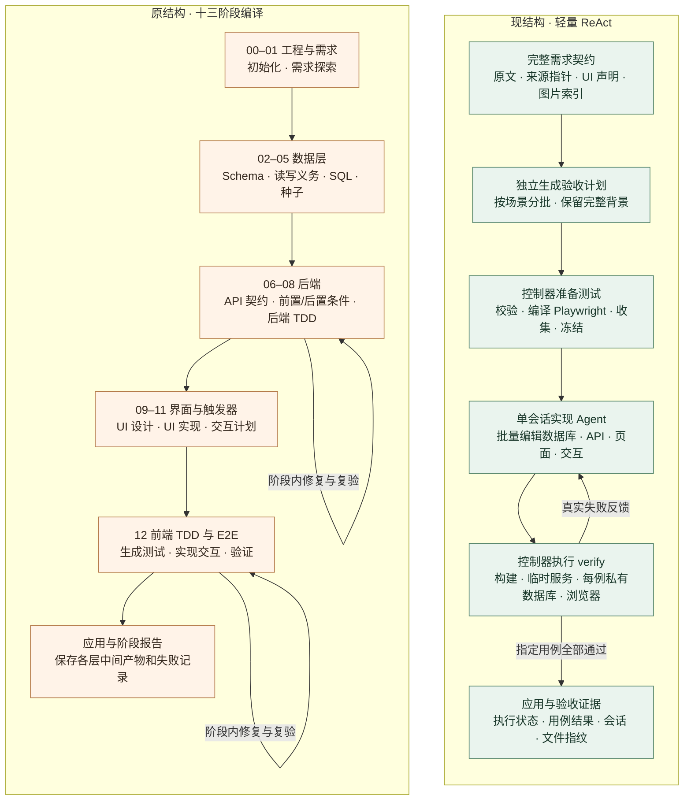
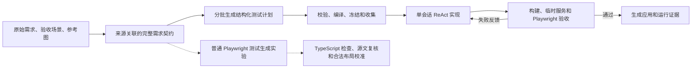

# Requirement Compiler Lite

本分支面向 ArcBench 网站生成任务，将 `requirements.yaml`、Given/When/Then 验收场景和参考图转换为 React + Express + SQLite 应用。当前 Agent 开发候选版本展示为 **Lite 0.1.0a2**，开发分支为 `experiment/react-lite`。

轻量引擎使用保留原文的需求契约、独立生成的浏览器测试和单会话 ReAct 实现循环。当前送测路径采用结构化测试计划，控制器将计划编译为 Playwright 并冻结后交给实现 Agent 验收。普通 Playwright 源码生成处于可行性实验阶段。

本文记录设计、相对原框架的具体变化、真实实验结果、版本管理和使用方式。详细过程见 [实验记录](REACT_EXPERIMENT.md)，本机产物位置和继续开发事项见 [交接说明](REACT_HANDOFF.md)。

## 当前验证范围

| 项目 | 已有证据 |
| --- | --- |
| Keep 从零生成 | 一轮总耗时 225.7 秒，自动测试 11/11，另存外部测试 11/11 |
| BookStack Lite 从零生成 | 一轮总耗时 369.6 秒，自动测试 12/12，另存外部测试 10/12 |
| BookStack 0.1.0a1 平台生成 | 自测 12/12，外部 6/12；原包本地复现同样为 6/12，定位到 Edit 和 New Page 的角色差异 |
| BookStack Lite 0.1.0a2 从零生成 | DeepSeek 官方 low，新生成应用自测 12/12、固定外部测试 12/12；生成约 574 秒，含外部评估总计约 629 秒，平台回送待验证 |
| StackOverflow Lite 从零生成 | 触及 900 秒总时限，状态为 TIME_LIMIT |
| StackOverflow 已有应用全量检查 | 经人工校准的冻结计划为 21 通过、6 失败、0 跳过 |
| 框架与入口回归 | 56 项通过 |
| 浏览器后端回归 | 18 个测试方法中包含 4 项实时浏览器检查，首轮两项方法发生外层进程超时，延长本地外层期限后复跑通过 |
| 0.1.0a1 导出检查 | 既有应用的构建与 Keep 外部 11 例回归通过，固定入口选择轻量引擎的接线检查通过 |

这些运行采用不同阶段的框架检查点。每项成绩对应自己的输入、模型配置、测试版本和运行记录。外部测试保存在本地回放目录，Keep 套件的独立官方来源仍待核实。BookStack Lite 的 12 个场景和完整 BookStack 的 35 个场景分别记录。

本次平台失败已完成原包复现与框架修正后的从零生成对照。0.1.0a2 的平台回送和其他任务验证继续保留待验证状态。PrestaShop、12306、Ctrip 的真实模型生成仍待执行。上述 StackOverflow 数字描述本地生成测试的执行情况，其中存在测试本身的定位错误。

## 设计目标与取舍

### 减少串行模型往返

原编译器依次设计数据库、义务、API、UI 和触发器，再分别验证和修复。轻量引擎直接使用原有全栈脚手架，由同一个实现会话完成跨层编辑，工具结果继续追加到会话中。一个响应可以批量读取或修改多个相关文件。

独立测试在实现前生成。实现 Agent 通过 `verify` 获得构建、启动和浏览器失败信息，控制器根据实际执行结果决定运行状态。恢复会话时，控制器先检查当前应用，给后续修复提供新的失败证据。

### 保留需求中的明确约束

需求编译保存原文、层级、未知元数据、图片材料、来源指针和内容指纹。默认声明填补未明确的属性，显式需求具有优先级。

UI 索引抽取带角色标注的名称，并识别部分明确的容器关系。它提供定位依据，完整的业务语义仍依赖原始条款。可访问名称、可见正文、动态数值和子动作分别检查。比如计数状态的名称可以是 `Title character count`，正文按需求显示长度。

### 将测试期望与应用实现分开生成

测试生成只读取源需求和材料契约。测试清单保存用例标题、需求来源和文件指纹，控制器检查实际收集到的用例。实现阶段写入应用目录，验收代码保存在独立的证据目录。

测试需要复核合法替代实现、对象身份、作用范围、前置数据、拒绝条件和刷新持久性。需求 ID 覆盖、来源指针有效、用例收集成功，分别提供不同层面的证据。断言是否忠实表达原文仍需校准。

### 采用网站任务所需的固定技术栈

脚手架使用 React、Express 和 SQLite，浏览器执行使用 Playwright。实现可同时修改数据库、服务和界面，平台需要的部署文件由项目模板提供。框架复用仓库现有模型传输、项目初始化、材料读取和进程管理。

### 用运行记录管理失败和成本

默认整轮上限为 900 秒、40 个实现循环。测试生成、收集和实现共享总期限。失败、超时、步数耗尽、跳过和未执行用例均保留原状态。

本地付费实验使用单独的累计账本和请求前预算守卫。平台运行使用平台注入的模型配置。预算辅助脚本保存在本地忽略目录中。

## 框架结构

### 原结构与现结构横向对比

比较基线为 `39eae6b`，当前候选结构为 `0.1.0a2`。两侧接收相同形式的原始需求、验收场景与参考图。



- 原结构按数据层、后端、UI 和触发器传递中间契约，各阶段执行自己的生成、检查与修复。
- 当前结构先准备独立验收，由一个实现会话完成跨层修改，构建和浏览器失败回到同一会话。
- 当前发布使用结构化测试计划。普通 Playwright 源码生成仍列为实验路径，详见下图与实验记录。

### 当前实现与研究路径



虚线部分记录本地研究路径。当前发布包通过实线流程执行。

创建、编辑等工作流动作在角色未指定时默认使用原生按钮，包括通过 URL 打开编辑器或创建表单的动作。原文显式角色和允许的替代形式优先，导航和记录目的地链接使用链接。实现与测试生成共享这项默认解释。

### 一轮运行的具体步骤

1. 读取完整源 YAML，建立需求契约、来源指针、UI 声明和输入指纹。
2. 准备独立的 Node Playwright 运行器。优先使用可用的 Chrome，否则安装 Chromium。
3. 按实现需求的场景数量分批，默认目标为每批 12 个场景。单项需求完整保留，实际批次可超过此值。每批保留完整需求上下文，仅收窄本批 `implementation_ids`。
4. 模型生成结构化测试计划。每批格式校验最多两次尝试，反馈和提案保留在证据目录。
5. 编译固定 Playwright 后端，校验来源与用例清单，收集可执行用例并冻结测试指纹。
6. 初始化应用，启动单会话实现 Agent。模型批量使用文件、进程和图像工具，原始需求继续作为实现依据。
7. `verify` 构建应用，在自动分配的本地端口启动临时服务，检查健康和页面，再执行冻结测试。结构化测试的每个用例使用私有数据库和应用进程。
8. 失败作为同一会话的观察继续修复。全部用例真实执行且通过时记录 `ACCEPTANCE_PASSED`。进程树由控制器清理。

测试生成的独立期限为 `min(总截止时间, 测试开始时间 + max(180, min(360, 总预算 × 0.45)))`，受整轮截止时间约束。默认测试运行遇到首个失败停止，剩余用例标记为未验证。全量诊断可在开发脚本中设置 `BrowserSuite(max_failures=0)`。

## 相对原十三阶段框架的变化

比较基线为 `39eae6b`，该检查点已经合入此前的清理和 Keep/UI 工作。实验分支的主要新增代码集中在 `infrastructure/react_agent/`。

### 原有阶段与轻量路径的职责对应

| 原阶段 | 原职责 | 轻量路径的处理方式 |
| --- | --- | --- |
| 00 | 项目初始化 | 复用原有 React/Express/SQLite 模板与初始化函数 |
| 01 | 需求探索 | 确定性读取原文、层级、材料和来源指纹 |
| 02 | 数据库 Schema 设计 | 实现会话按完整用户流程设计并编辑数据库 |
| 03 | 推断数据库义务 | 明确条款由源契约和验收场景传给实现与测试 |
| 04 | 校验数据库义务 | 在真实用户流程中检查对应结果，义务账本不参与轻量调度 |
| 05 | 数据库实现 | 与服务、UI 一起跨层实现和构建 |
| 06 | API 设计 | 实现会话按需要设计服务接口 |
| 07 | API 契约检查 | 浏览器验收检查用户可观察结果，Agent 可用定向 API 检查辅助诊断 |
| 08 | 后端 TDD 实现 | 实现会话完成后端，使用整条应用链路反馈修复 |
| 09 | UI 设计 | 直接依据条款、角色名称和参考图实现界面 |
| 10 | UI 实现 | 与交互和服务连接一起编辑 |
| 11 | 前端触发器设计 | 同一实现会话完成用户动作、状态和数据连接 |
| 12 | 前端 TDD 和 E2E | 独立测试提前生成，统一由 `verify` 执行并返回反馈 |

### 执行和约束的具体差异

| 方面 | 原框架 | 当前轻量引擎 |
| --- | --- | --- |
| 调度 | 13 个顺序 pass，各自含任务循环 | 测试准备加一个持续实现会话 |
| 中间表示 | Schema、读写义务、SQL、API P/Q、UI IR、触发器计划 | 原文契约、UI 词法索引、结构化验收计划 |
| 编辑范围 | 阶段和任务管理的写入范围 | 应用内跨层批量编辑 |
| 上下文 | 阶段载荷、发现和检索反馈 | 原文契约加追加式动作/观察历史 |
| 测试构造 | 领域内分阶段生成、审查、修复 | 实现前独立生成并冻结浏览器验收 |
| 用例数据 | 由领域实现与测试流程管理 | 结构化后端每例私有数据库，唯一值模板维持字段格式 |
| 恢复 | 原阶段检查点和产物 | 输入指纹校验、会话恢复和控制器先验收 |
| 完成判定 | 阶段状态汇总 | 实际构建、启动和指定验收结果 |
| 平台可追溯性 | 已有 runtime hooks 与阶段可视化 | 运行报告、轨迹和指纹，七区域 hooks 接线待完成 |
| 检索与记忆 | BM25、发现、约定和阶段知识 | 完整契约与会话历史，按需检索和压缩待评估 |

本分支为实验新增了独立模块，仓库中同时保存两种执行引擎。轻量执行省去了原阶段调度和中间契约生成，代码规模与运行开销分别记录。Git 差异可直接核对。

```bash
git diff --stat 39eae6b..experiment/react-lite
git log --oneline 39eae6b..experiment/react-lite
```

### 文件与实现位置

| 文件 | 具体职责 |
| --- | --- |
| [main.py](main.py) | `staged/react` 入口选择，读取发布清单默认引擎，兼容平台路径环境变量 |
| [requirements.py](infrastructure/react_agent/requirements.py) | 原文契约、来源指针、层级、材料、UI 声明和默认解释 |
| [submission.py](infrastructure/react_agent/submission.py) | 浏览器准备、分批测试编译、统一期限、收集和实现接线 |
| [test_plan.py](infrastructure/react_agent/test_plan.py) | 测试计划提示、格式校验、来源校验、名称解释与编译 |
| [plan_runtime.ts](infrastructure/react_agent/plan_runtime.ts) | 确定性执行动作和断言，处理变量和精确语义定位 |
| [application_fixture.ts](infrastructure/react_agent/application_fixture.ts) | 每例私有数据库、应用服务和进程清理 |
| [runner.py](infrastructure/react_agent/runner.py) | 单会话循环、真实验收、恢复、截止时间和状态记录 |
| [prompt.py](infrastructure/react_agent/prompt.py) | 网站实现约束、工具协议、默认解释和验证要求 |
| [tools.py](infrastructure/react_agent/tools.py) | 列目录、分段读取、写入、唯一替换和参数数组命令 |
| [verification.py](infrastructure/react_agent/verification.py) | Playwright 收集/执行、错误分类、需求结果及冻结指纹检查 |
| [browser_tools.py](infrastructure/react_agent/browser_tools.py) | 准备 `@playwright/test@1.55.0` 和浏览器 |
| [provenance.py](infrastructure/react_agent/provenance.py) | 框架源码、基础提示、Git 与导出环境的内容身份 |
| [acceptance.py](infrastructure/react_agent/acceptance.py) | 普通 Playwright 源码生成实验，支持指定需求范围并保留完整上下文 |
| [scripts/evaluate_react.py](scripts/evaluate_react.py) | 从原始需求生成新应用，生成结束后执行固定外部套件并保存完整结果 |
| [scripts/package.py](scripts/package.py) | 依照 Git 忽略规则打包，记录版本、引擎、提交和文件指纹 |
| [test_react_agent.py](tests/test_react_agent.py) | 实现循环、工具、来源、恢复、验收和普通测试批次的框架回归 |
| [test_react_submission.py](tests/test_react_submission.py) | 自动测试编译、共享期限、失败记录和平台入口回归 |
| [test_browser_plans.py](tests/test_browser_plans.py) | 测试后端、语义变体、状态数值、邮箱保形和数据隔离回归 |
| [test_package_release.py](tests/test_package_release.py) | 发布版本、引擎、字节指纹和凭据排除回归 |

`infrastructure/compiler.py` 和 `infrastructure/stages/passes/` 提供原有十三阶段引擎。模型传输继续复用 `infrastructure/shared/models/`，进程处理复用 `infrastructure/utils/processes.py`，模板继续位于原项目初始化模块中。

## 迭代过程、发现与成效

| Git 检查点 | 具体变化 | 证据和影响 |
| --- | --- | --- |
| `513b5fa` | 来源关联契约、单会话实现、独立验收 | 建立跨层网站生成原型 |
| `671be45` | 自动结构化验收、每例隔离、运行身份、固定送测入口 | Keep 和 BookStack Lite 进入自动生成测试的完整链路 |
| `1985aac` | 按场景规模分批，增加显式表单标签关联和优先 `verify` 约定 | 控制单次输出规模，针对已有标签兼容差异保留回归 |
| `2a7a00c` | 分批保留完整上下文，恢复会话先实际验收 | 保留跨批前置流程，并在恢复时向模型提供实际检查结果 |
| `9119d9f` | 记录 StackOverflow 首轮超时和坏邮箱数据 | 保存模型为错误测试放宽应用校验的失败样本 |
| `ef9bc33` | `${unique}` 位置模板和旧邮箱计划兼容 | 标识进入邮箱 local part，保留负例和固定种子，原生邮箱校验回归通过 |
| `bce96bd` | 记录动态 status 语义错误 | 识别出框架把状态名称当作正文的误判 |
| `e4dc952` | `visible` 只验证可见性及约定名称，正文显式断言；兼容旧 step-level `within`，拒绝冲突和未知选项 | 数值计数状态可表达，原有固定消息由显式内容断言继续检查 |
| `26fb48d` | 普通测试生成可选需求范围、完整背景、输出范围校验 | 小范围普通 Playwright 可行性实验可独立复现 |
| `f8779c8` | 记录普通测试局限、全量 27 例检查和导出包验证 | 给出可核查的当前上限和失败分类 |
| `0.1.0a1` | 整理分支 README，发布清单自动读取项目版本 | 首个正式编号的实验发布，历史试验继续通过 Git 提交和目录名称定位 |
| `1b576d5` / `0.1.0a2` | 统一未指定角色的工作流动作默认值，补充从零生成后执行固定外部验收的脚本 | 原包 6/12 复现，新框架从原始需求生成的 BookStack Lite 在固定外部用例中 12/12 |

### 时间与模型消耗的观察

归档的旧 Keep 日志记录 Agent 执行约 60 分 41 秒，含 152 条 `MODEL CALL` 标记，调用输入输出标记间隔合计约 49 分 44 秒。轻量 Keep 试验总耗时约 3 分 46 秒，应用阶段约 2 分 29 秒、8 个循环、3 次图片分析。BookStack Lite 应用阶段约 5 分 30 秒、18 个循环、4 次图片分析。

模型、运行环境、输入版本和测试流程存在变化，速度因果比较仍需同条件实验。累计费用账本截至本轮覆盖 114 次成功与失败的请求，估算 0.2685828 美元，包含不同任务、复核和被拒绝的试验。单轮成本需要读取该轮 usage。

### 测试质量暴露的问题

- BookStack 首轮自动测试通过 12/12，外部测试为 10/12。两例失败集中在预填多行字段的标签定位。旧应用随后使用外部测试恢复修复的过程仅用于诊断。框架优化的验证采用从原始需求重新生成应用后执行外部测试。
- StackOverflow 的旧唯一值处理破坏邮箱格式，模型随之放宽应用校验。框架已修复数据生成方式，原失败应用和测试版本保留。
- 动态状态曾被隐式要求包含自己的可访问名称。后端已修正，依赖旧隐式行为的测试内容覆盖仍需复核。
- StackOverflow 全量 27 例中，三个失败涉及全页同名标题或 Score，另一个导航用例把问题列表的 button 用到搜索结果的 link。两个评论用例发现 Add a comment 位于 Question post 之外，与明确的 `within` 条款冲突，前置创建身份另有覆盖遗漏。
- 普通 Playwright v5 的两例在约 20.9 秒生成并收集，TypeScript 发现导入拼写错误。v6 在一次修正后约 17.5 秒生成并通过类型检查，合法 DOM 布局校准仍为 2/4，已有应用对照为 1/2。答案 Author 的具体 role 归因保留待定。
- 0.1.0a2 的本地生成没有向模型提供外部测试，生成结束后固定外部 12 例通过。自生成测试仍把原文允许 button/link 的页面条目收窄为 link，造成一次额外修复，该语义与成本问题继续作为优化项。
- 独立模型复核也产生过重复发现和错误引用。原文、代码引用需逐字校验，语义判断继续复核。

## 已知限制与下一轮优化

| 问题 | 当前事实 | 后续实验方向 |
| --- | --- | --- |
| 测试覆盖 | 需求 ID 和用例收集可以核对，逐条断言仍有遗漏 | 依据已有 Given/When/Then 检查动作、对象和可观察结果 |
| 对象归属 | 同名字段、合法嵌套和跨页面角色容易混用 | 用源文限定对象范围，保留同名及合法布局反例 |
| 结构化测试表达力 | 目前缺少基线捕获、相对算术和合法替代分支 | 对照普通 Playwright 的维护量、误判率和完整执行成本 |
| 普通测试生成 | 类型检查能检出技术错误，语义校准仍有失败 | 控制修订次数，复核后再决定是否进入默认链路 |
| 会话成本 | 原文较大，历史持续追加，失败后整套验收重复运行 | 测量上下文和验收耗时，再评估压缩与定向检查 |
| 需求载荷 | 六个 Lite 输入的契约约 15.8–143.1 KB，UI 索引占约 10–22% | 根据依赖完整性和实测收益决定裁剪范围 |
| 平台适配 | Windows Chrome 有实际结果 | 补充 Linux/Chromium 和平台送测记录 |
| 可追溯显示 | 轻量引擎已保存来源、轨迹、指纹 | 接入平台七区域 hooks |
| 通用性 | Keep、BookStack Lite 和 StackOverflow 已进行模型试验 | 验证其他 Lite 任务的完整生成，保留失败样本 |

## 环境与运行

需要 Python 3.11+、Node.js 22.12+、npm 和 uv，工具应位于 PATH。依赖 `better-sqlite3` 在缺少预编译产物时需要原生编译工具。

| 平台 | 原生编译工具 |
| --- | --- |
| Windows | Visual Studio Build Tools 的 Desktop development with C++，以及 npm 可用的 Python |
| macOS | Xcode Command Line Tools |
| Linux | Python、make 和 C++ 编译器 |

安装 Python 依赖，在本地配置模型服务。

```bash
uv sync
```

PowerShell 中创建本地配置文件。

```powershell
if (-not (Test-Path .env)) { Copy-Item .env.example .env }
```

bash/zsh 中创建本地配置文件。

```bash
if [ ! -f .env ]; then cp .env.example .env; fi
```

填写自己的 `OPENAI_API_KEY`、`OPENAI_BASE_URL` 和 `MODEL`。图像模型使用相应的 `VISUAL_*` 配置。模型配置和服务能力由实际端点决定，平台注入的环境变量具有优先级。`MODEL_REASONING` 和 `VISUAL_REASONING` 默认采用 `low`。本地预算实验曾显式使用 `none` 做测试源码生成对照。

### 轻量网站生成

输入目录包含 `requirements.yaml` 和它引用的图片。输出目录单独指定。

```bash
uv run main.py input --output-dir outputs/demo --engine react
```

首次运行会自动准备 Node Playwright 运行器，可能需要 npm 和浏览器下载网络访问。Python Playwright 和 Node Playwright 各自使用匹配的浏览器版本。

PowerShell 可设置整轮限制，并复用已有 Node Playwright CLI。

```powershell
$env:REACT_TIME_BUDGET='900'
$env:REACT_MAX_STEPS='40'
$env:REACT_PLAYWRIGHT_CLI='C:/path/to/node_modules/@playwright/test/cli.js'
$env:REACT_BROWSER_CHANNEL='chrome'
uv run main.py input --output-dir outputs/demo --engine react
```

`REACT_PLAYWRIGHT_CLI` 留空时自动准备工具。运行器的文件工具限制输入和输出路径，命令工具以宿主进程权限执行。子应用和测试进程清除模型密钥环境变量。部署环境负责进程和文件访问隔离。

### 原十三阶段入口

```bash
uv run playwright install chromium
uv run main.py input --output-dir outputs/staged-demo --engine staged
```

`--model-log` 和 `--port` 属于原阶段流程的配置。轻量验收服务使用临时端口，生成应用按模板部署配置运行。

### 启动生成应用

```bash
cd outputs/demo
npm run db:init
npm run build
npm start
```

默认访问 `http://localhost:3000`。平台使用生成应用的 `deploy.sh`。

### 恢复实现会话

已有冻结测试、Playwright CLI 和应用目录时可以恢复。需求指纹在恢复前校验。

```bash
uv run python -m infrastructure.react_agent.runner input -o outputs/demo --resume --skip-install --acceptance-dir PATH_TO_FROZEN_TESTS --playwright-cli PATH_TO_PLAYWRIGHT_CLI --browser-channel chrome
```

该命令恢复实现会话。完整测试编译的运行报告继续保存在原证据目录。

## 运行记录与状态

| 位置 | 内容 |
| --- | --- |
| `OUTPUT/.arc/react-submission.json` | 自动测试准备、总耗时和最终状态 |
| `OUTPUT/.arc/react-report.json` | 实现循环、模型/工具时间、usage 和行为验证状态 |
| `OUTPUT/.arc/react-trajectory.jsonl` | 动作、观察和修复轨迹 |
| `OUTPUT/.arc/react-session.json` | 恢复所需会话 |
| `OUTPUT/.arc/requirements.json` | 原始结构化需求 |
| `OUTPUT/.arc/requirement-contracts.json` | 需求索引、UI 声明和来源 |
| `OUTPUT/.arc/framework-manifest.json` | 源码、基础提示、Git 和内容指纹 |
| `OUTPUT/.arc/react-instructions.txt` | 实现基础提示 |
| `OUTPUT/.arc/verification/` | 浏览器结果、截图、trace、服务日志和私有数据库 |
| `OUTPUT_NAME.react-evidence/RUN_ID/` | 位于输出同级的测试提案、冻结套件、收集结果和完整编译报告 |

`ACCEPTANCE_PASSED` 表示指定套件全部执行并通过。只执行构建和启动的直接 runner 会使用 `BUILD_AND_STARTUP_PASSED`，其 `behavior_verified` 为 false。`TIME_LIMIT`、`STEP_LIMIT`、`FAILED` 和 `INTERRUPTED` 保留对应原因。未执行的用例标记为 `UNVERIFIED`。

## 本地回归命令

```bash
uv run python -m unittest discover -s tests -p 'test_react*.py'
uv run python -m unittest discover -s tests -p 'test_browser_plans.py'
uv run python -m unittest discover -s tests -p 'test_package_release.py'
```

浏览器后端检查默认跳过实时浏览器项。PowerShell 中可显式启用。

```powershell
$env:REACT_BROWSER_TESTS='1'
$env:REACT_PLAYWRIGHT_CLI='C:/path/to/node_modules/@playwright/test/cli.js'
$env:REACT_BROWSER_CHANNEL='chrome'
uv run python -m unittest discover -s tests -p test_browser_plans.py
```

`tests/` 是框架回归测试。送测运行中的网站验收从用户提供的需求动态生成。历史实验的应用、计划和日志保存于本机忽略的 `output/`，Git 版本保存框架与提示词。

## 从零生成与固定外部验收

本地候选验证使用新输出目录，依次执行框架的完整生成、自生成验收及固定外部用例。外部测试作为生成结束后的检查输入。自动测试通过而外部测试失败时，整轮结果为失败。

```bash
uv run python scripts/evaluate_react.py input -o outputs/fresh-trial --external-tests PATH_TO_EXTERNAL_TESTS --playwright-cli PATH_TO_PLAYWRIGHT_CLI --channel chrome --test-timeout-ms 10000
```

结果写入 `outputs/fresh-trial.evaluation.json`，保存框架指纹、模型运行报告、应用源码指纹、外部用例指纹和完整失败结果。脚本要求新的输出路径，生成应用作为这次框架验证的唯一应用实例。BookStack 本次平台每例为 10 秒，本地可通过参数匹配对应评测的用例期限。

## 版本管理与送测包

### 发布版本、提交和试验轮次

- `pyproject.toml` 的 `project.version` 为 Agent 发布版本的唯一配置来源，采用 PEP 440。当前开发候选为 `0.1.0a2`，已经编号发布的历史版本为 `0.1.0a1`。
- 每个对外送测版本分配递增版本号。后续提示词、生成逻辑或测试语义调整递增 alpha 序号，较大的架构实验可进入 `0.2.0a1`。
- 轻量框架统一使用 `Lite` 标识，版本展示如 `Lite 0.1.0a3`，后续标签采用 `lite-v0.1.0a3`。数值版本继续由 `pyproject.toml` 管理。历史标签 `react-v0.1.0a1`、`react-v0.1.0a2` 对应各自的已发布快照。
- `keep-v6-auto`、`bookstack-v3-auto`、`focused-v6` 是试验目录名称，一次源码版本可以对应多个试验。历史轮次通过原有提交和指纹追踪。
- `uv.lock` 的本地项目版本随 `pyproject.toml` 更新。打包器自动读取项目版本，写入 `agent-release.json`。
- 后续送测 ZIP 按 `Lite 用途 YYYYMMDD dzs.zip` 命名，例如 `Lite Workflow Controls YYYYMMDD dzs.zip`。0.1.0a2 已由用户将用途改为 `light` 后交组长送测。版本号和源码提交记录在包内清单，整包 SHA256 用于核对实际上传文件。

### 打包

在已提交的仓库根目录执行，输出放入忽略目录。

```bash
uv run python scripts/package.py --engine react --output "output/releases/Lite Workflow Controls YYYYMMDD dzs.zip"
```

包根目录包括 `main.py`、Python 依赖、应用模板和 `arcbench-agent-runtime/`。`agent-release.json` 记录以下字段。

| 字段 | 用途 |
| --- | --- |
| `schema_version` | 发布清单格式 |
| `version` | 来自 `pyproject.toml` 的 Agent 版本 |
| `engine` | 固定平台命令所使用的默认引擎 |
| `source_commit` | 打包源码提交 |
| `dirty_paths` | 打包时未提交路径，供核对快照完整性 |
| `files` | 包内各文件的 SHA256 |

源码 checkout 默认选择 `staged`。带有 `engine=react` 发布清单的送测包，通过平台固定的 `main.py INPUT --output-dir OUTPUT` 命令进入轻量引擎。

打包器依据 Git 忽略规则排除 `.env`、Git 元数据、本地输入、外部检出目录、生成输出和旧 ZIP。正式上传前核对清单、文件指纹、入口选择和实际运行记录。0.1.0a1 平台生成结果已复现为 6/12，0.1.0a2 从零生成的本地固定外部验收为 12/12。新候选包的平台回送待验证。

## 参考策略与研究记录

本地实现采用单会话循环、批量工具和独立执行验收。mini-SWE-agent 的线性动作/观察循环、Deep Agents v0.7 的提示与工具描述精简，以及应用 harness 的浏览器验证和会话交接提供了参考。研究链接和适用范围核对日期为 2026-11-15。[mini-SWE-agent](https://mini-swe-agent.com/latest/advanced/control_flow/) · [Deep Agents v0.7](https://www.langchain.com/blog/deep-agents-v0-7) · [Anthropic application harness](https://www.anthropic.com/research/harness-design-long-running-apps)

完整的基线分析、策略对照、原始失败和实验边界见 [REACT_EXPERIMENT.md](REACT_EXPERIMENT.md)。
