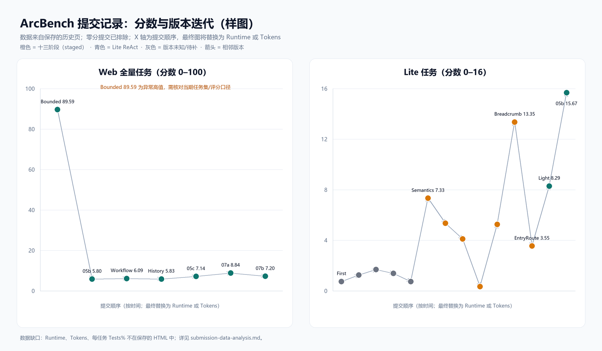

# 提交数据与版本分析（中期报告用）

> 数据源：`output/ArcBench_web_scores.html`（Web 全量任务，History 11 条）与
> `output/ArcBench_lite_scores.html`（Lite 任务，History 18 条），以及 `output/*.zip`。
> 解析脚本：`midterm-pre/analyze_submissions.py`；样图脚本：`midterm-pre/draw_score_chart.py`。
>
> 先说结论：**保存的 HTML 只有"提交名 + 时间 + 总分"，没有每任务 Tests%、Runtime、Tokens**。
> 详情抽屉在 HTML 里是空的，详情接口需要登录 Cookie（未登录返回 401）。因此本文件先完成
> 可确定的部分（版本映射、分数/趋势、M8-M10 复盘、样图），并列出补数清单；拿到详情导出后
> 可以直接换掉样图的 X 轴。

---

## 1. 口径与数据限制

### 1.1 已拿到的数据

- 两次竞赛的提交历史：提交名、提交时间、总分（`<strong>` 里的 Score）。
- 本地 `output/` 下的 18 个 ZIP：名称、时间、包内 `agent-release.json` 的版本/引擎/commit。
- 本地运行产物：`output/M8-M10_keep/` 等（用于复盘，不是平台 Runtime）。

### 1.2 没拿到的数据

| 字段 | 状态 | 原因 |
| --- | --- | --- |
| 每任务 Tests%（通过的外部测试占比） | 缺失 | 需要点开每条提交的 Details；保存的 HTML 中详情抽屉为空 |
| Runtime | 缺失 | 同上；历史列表只有总分 |
| Tokens | 缺失 | 同上 |
| 每任务失败明细 | 缺失 | 同上；只有本地 `ArcBench.html` 能看单个任务 |

证据：

- `ArcBench_*_scores.html` 末尾的 `<div class="ant-drawer-body"></div>` 是空的；
- 历史接口 `GET /api/competitions/{competition}/submissions` 未登录返回 **401**；
- 页面 JS 中详情是点击后异步加载的，静态保存不会带数据。

### 1.3 分数口径

- 这里的"分数"是平台**总分**，不等于 Tests%。Tests% 是每任务通过的外部测试占比，需要 Details。
- 不同轮次的任务集、需求数、外部测试数、模型配置都可能变化，**不能把不同竞赛/不同版本的分数直接横比**。
- 按用户要求：**0 分提交视为出错/主动停止，排除**；版本未知的提交保留数据、版本留空。

---

## 2. 提交清单（按时间升序）

### 2.1 Web 全量任务（11 条，排除 4 条 0 分）

| 日期 | 提交 | 总分 | 版本（ZIP → 发布版本） | 处理 |
| --- | --- | ---: | --- | --- |
| 11-03 | zmr20245036@sjtu.edu.cn | 0.00 | — | 排除 |
| 11-03 | zmr20245036@sjtu.edu.cn | 0.00 | — | 排除 |
| 11-15 | Light 20261115 dzs | 0.00 | `Light 20261115 dzs` → 0.1.0a2 | 排除（同包在 Lite 为 8.29） |
| 11-15 | Lite Bounded 20261115 dzs | **89.59** | `Lite Bounded Runtime 20261115 dzs` → 0.1.0a4 | 保留；异常高值，见 §4.2 |
| 11-17 | Lite 05b Log Preview 20261116 dzs | 5.80 | `Lite 05b Log Preview 20261116 dzs` → 0.1.0a5.post1 | 保留（同包在 Lite 为 15.67） |
| 11-18 | Lite Workflow Groups 20261118 dzs | 6.09 | `Lite Workflow Groups 20261118 dzs` → 0.1.0a6 | 保留 |
| 11-19 | Lite History Search 20261119 dzs | 5.83 | `Lite History Search 20261119 dzs` → 0.1.0a6.post1 | 保留 |
| 11-19 | Lite 05c Log Labels 20261119 dzs | 7.14 | `Lite 05c Log Labels 20261119 dzs` → 0.1.0a5.post2 | 保留 |
| 11-20 | Lite 07a Input Hints 20261120 dzs | **8.84** | `Lite 07a Input Hints 20261120 dzs` → 0.1.0a7 | 保留；Bounded 之外最高 |
| 11-20 | Lite 07b Input Hints and Obligations 20261120 dzs | 7.20 | `Lite 07b Input Hints and Obligations 20261120 dzs` → 0.1.0a7.post1 | 保留 |
| 11-20 | Lite 07d Scenario Coverage 20261120 dzs.zip | 0.00 | `Lite 07d Scenario Coverage 20261120 dzs.zip` → 0.1.0a7.post3 | 排除（最新一条 0 分，疑似出错/停止） |

### 2.2 Lite 任务（18 条，排除 4 条 0 分）

| 日期 | 提交 | 总分 | 版本（ZIP → 发布版本） | 处理 |
| --- | --- | ---: | --- | --- |
| 11-04 | First Deployable Agent | 0.74 | —（版本未知） | 保留 |
| 11-04 | Full-hooked and E2E Enhanced | 1.25 | —（版本未知） | 保留 |
| 11-05 | Fix E2E Reuse | 0.00 | —（版本未知） | 排除 |
| 11-05 | D1 Implementation | 0.00 | `compiler_d1` | 排除 |
| 11-05 | E2E Re-fixed | 0.00 | `compiler_e2e_refix` | 排除 |
| 11-05 | Nowicthelight | 1.68 | —（版本未知） | 保留 |
| 11-05 | Nowicthelight | 1.38 | —（版本未知） | 保留 |
| 11-05 | Baseline Test | 0.74 | —（版本未知） | 保留 |
| 11-05 | Semantics Enhanced | **7.33** | `semantics` | 保留；语义 IR 后的跃升 |
| 11-07 | UI Naming 20261107 | 5.35 | `compiler-ui-naming-20261107` | 保留 |
| 11-07 | Nowicthelight | 0.00 | —（版本未知） | 排除 |
| 11-07 | GYP No.1 | 4.10 | `gyp.no1` | 保留 |
| 11-07 | Full-hooked 20261107 dzs | 0.34 | `compiler-hooks` | 保留（明显回退） |
| 11-09 | IR amended 20261109 zmr | 5.25 | `ir_amended` | 保留 |
| 11-11 | Breadcrumb-fixed 20261111 zmr | **13.35** | `breadcrumb` | 保留；staged 峰值 |
| 11-13 | Entry Route and Probes 20261113 zmr | 3.55 | `entry_route`（M8/M9/M10） | 保留；较 Breadcrumb -9.80 |
| 11-15 | Light 20261115 dzs | 8.29 | `Light 20261115 dzs` → 0.1.0a2 | 保留；Lite 引擎首条 |
| 11-17 | Lite Log Preview 20261116 dzs | **15.67** | `Lite 05b Log Preview 20261116 dzs` → 0.1.0a5.post1 | 保留；Lite 峰值（当前 leaderboard） |

> "版本未知"的提交保留了分数/时间，但 ZIP 不在 `output/` 中（可能是组员直接发 ZIP、尚未推到远端）。
> 其中 `First Deployable Agent` / `Full-hooked and E2E Enhanced` / `Nowicthelight` / `Baseline Test`
> 可以按时间推断属于 staged 阶段，但没有可核对的包，标注为"版本未知"。

---

## 3. 版本映射（ZIP → 发布版本 → 提交）

| ZIP | 发布版本 | 引擎 | 平台提交（竞赛/分数） |
| --- | --- | --- | --- |
| `compiler_d1.zip` | — | staged | Lite / 0.00（排除） |
| `compiler_e2e_refix.zip` | — | staged | Lite / 0.00（排除） |
| `semantics.zip` | — | staged | Lite / 7.33 |
| `compiler-ui-naming-20261107.zip` | — | staged | Lite / 5.35 |
| `gyp.no1.zip` | — | staged | Lite / 4.10 |
| `compiler-hooks.zip` | — | staged | Lite / 0.34 |
| `ir_amended.zip` | — | staged | Lite / 5.25 |
| `breadcrumb.zip` | — | staged | Lite / 13.35 |
| `entry_route.zip` | — | staged（M8/M9/M10） | Lite / 3.55 |
| `Light 20261115 dzs.zip` | 0.1.0a2 | Lite | Lite / 8.29；Web / 0.00（排除） |
| `Lite Bounded Runtime 20261115 dzs.zip` | 0.1.0a4 | Lite | Web / 89.59 |
| `Lite 05b Log Preview 20261116 dzs.zip` | 0.1.0a5.post1 | Lite | Lite / 15.67；Web / 5.80 |
| `Lite Workflow Groups 20261118 dzs.zip` | 0.1.0a6 | Lite | Web / 6.09 |
| `Lite History Search 20261119 dzs.zip` | 0.1.0a6.post1 | Lite | Web / 5.83 |
| `Lite 05c Log Labels 20261119 dzs.zip` | 0.1.0a5.post2 | Lite | Web / 7.14 |
| `Lite 07a Input Hints 20261120 dzs.zip` | 0.1.0a7 | Lite | Web / 8.84 |
| `Lite 07b Input Hints and Obligations 20261120 dzs.zip` | 0.1.0a7.post1 | Lite | Web / 7.20 |
| `Lite 07d Scenario Coverage 20261120 dzs.zip` | 0.1.0a7.post3 | Lite | Web / 0.00（排除） |

注意：

- 发布版本顺序不是提交顺序：`05c` 是 0.1.0a5.post2，晚于 `05b` 的 a5.post1，但早于 `Workflow` 的 a6；
  `History` 是 a6.post1；`07a/07b/07d` 是 a7 系列。表中按**提交时间**排序，版本号只作辅助。
- `Light` 与 `05b` 是同一个 ZIP 分别提交到两个竞赛，所以各有两个分数；`Light` 在 Web 为 0，按规则排除，
  但 Lite 的 8.29 保留。

---

## 4. 分数分析

### 4.1 保留样本（21 条）

- Web 7 条：Bounded 89.59、07a 8.84、07b 7.20、05c 7.14、Workflow 6.09、History 5.83、05b 5.80。
- Lite 14 条：05b 15.67、Breadcrumb 13.35、Light 8.29、Semantics 7.33、UI Naming 5.35、IR 5.25、
  GYP 4.10、Entry Route 3.55、Nowic 1.68/1.38、Hooks+E2E 1.25、First 0.74、Baseline 0.74、Hooks 0.34。

### 4.2 Web：Bounded 89.59 是异常点

- Bounded（0.1.0a4）比同竞赛第二名 07a（8.84）高 **80.75**，比后续 6 条（5.80–8.84）高一个数量级。
- 有两种可能，当前 HTML 无法区分：
  1. 当期 Web 任务集/评分权重与后续不同（任务数、需求数、外部测试数发生变化）；
  2. 后续 Lite 版本在 Web 全量任务上确实出现了大幅回退。
- **不要**把 89.59 当作"稳定水平"画进趋势线；建议在图中单独标注为异常点，并在拿到 Tests%/Runtime 后再判断。
- Bounded 之后，Lite 系列在 Web 上的分数为：5.80 → 6.09 → 5.83 → 7.14 → **8.84** → 7.20（07d 0 排除）。
  整体是小幅上升后回落的平台期，尚未回到 Bounded 的分数。

### 4.3 Lite：两条线，峰值在 05b

**staged 阶段（11-04 ~ 11-13）**：

```
0.74 → 1.25 → 1.68 → 1.38 → 0.74 → 7.33 → 5.35 → 4.10 → 0.34 → 5.25 → 13.35 → 3.55
        First  Hooks+E2E Nowic  Nowic  Baseline Semantics UI Naming GYP Hooks IR Breadcrumb EntryRoute
```

- **+6.59（Semantics）**：语义 IR/可访问名进入设计后，分数第一次上到 7 分档；
- **+8.10（Breadcrumb）**：导航守卫 + 回归重放后到 13.35，是 staged 的最好成绩；
- **-9.80（Entry Route/M8-M10）**：M8/M9/M10 这一轮明显回退；Keep 的 4 条外部超时已复盘（§5），
  Web/Lite 的总分回退与它同源（入口/地标/覆盖率的语义回归）；
- 中间 `Hooks 0.34` 是一次明显异常/回退，值得单独对照 ZIP 内容，但当前缺少每任务明细。

**Lite 阶段（11-15 ~ 11-17）**：

- Light 8.29（a2）→ 05b **15.67**（a5.post1），比 staged 峰值 13.35 高 **2.32**；
- 05b 同时是当前 Lite 的 leaderboard 提交（页面选中项）。

### 4.4 关键变化（可用于报告叙事）

| 变化 | 数值 | 解释 |
| --- | ---: | --- |
| First → Semantics | +6.59 | 语义 IR / 可访问名第一次系统性进入设计 |
| IR → Breadcrumb | +8.10 | 导航守卫 + 回退重放，修复"两个 navigation"回归 |
| Breadcrumb → Entry Route（M8/M9/M10） | **-9.80** | 入口/地标规则引入新回归；Keep 4 条超时 |
| Light → 05b（Lite） | +7.38 | 轻量引擎 + 测试/运行时限制调整后的峰值 |
| Bounded → 05b（Web） | -83.79 | Bounded 异常高值，不能直接解释为回退 |

### 4.5 结论（在缺少 Tests% 的前提下）

1. **总分能看出阶段趋势，但不能替代 Tests%**：Bounded 的 89.59 和 07d 的 0 都说明总分会受任务集/异常影响。
2. **语义 IR/壳/导航守卫是有效的**：staged 从 0.74 到 13.35，主要跃升发生在这些改动之后。
3. **M8/M9/M10 这一轮是负向的**：Lite 总分 -9.80，Keep 外部 7/11；根因可定位（§5），不是"规则没用"，
   而是实现/兜底没接住（502 空设计 + 导航命名 + 未跑预检）。
4. **Lite 引擎有潜力**：05b 到 15.67（Lite 历史最高），但 Web 侧 Bounded 之后仍在 5–9 平台期，
   需要 Tests%/Runtime 才能判断是"正确率不足"还是"任务集变化"。

---

## 5. 运行复盘：M8-M10 Keep（外部 7/11）

产物：`output/M8-M10_keep/template/`；任务：Keep（6 需求 / 11 外部用例）；
结果：**7/11**，4 条失败全部是超时——REQ-1.1 一条、REQ-2.4 三条。

### 5.1 失败映射

| 需求 | 外部用例 | 现象 | 直接原因 |
| --- | --- | --- | --- |
| REQ-1.1 | 打开 workspace / 检查 Sidebar、Notes、Archived、Toggle | 超时 | 应用导航可访问名是 **"Sidebar navigation"**，外部按 `"Sidebar"` 找 |
| REQ-2.4 | Archive note / Undo / Unarchive（3 条） | 超时 | 设计里 **REQ-2.4 没有任何元素**；Archive/Undo/Unarchive/status 都不存在 |

### 5.2 根因 A：REQ-2.4 的设计调用 502，任务被跳过

日志（`output/M8-M10_keep/template/compiler.log`）：

- L33036：REQ-2.4 的 UI 设计模型调用 `ef4bd769`；
- L33043–33049：`MODEL FAILED`，`Round-trip latency: 541.41 s`，
  `InternalServerError: 502 ... Upstream connection, response size or timeout error`；
- L33052：`09_design_ui / REQ-2.4 | FAILED; continuing`；
- `compilation.json`：`09_design_ui = COMPLETED_WITH_FAILURES`，`12_implement_frontend_tdd = COMPLETED_WITH_FAILURES`；
- `.arc/ui_design.json`：`REQ-2.4 -> []`，三个 REQ-2.4 步骤也全部为 `[]`；
- `.arc/frontend_e2e.json`：`REQ-2.4 = NO_TRIGGERS`，summary 只有 5 个 requirement。

**关键机制**：

1. `propose_json` 只对"响应读不懂/校验失败"做修复重试，**不对 502/超时等传输错误重试**；一次 502 就把
   该需求标成 FAILED；
2. `TaskFailures.finish()` 在阶段末尾发现失败会 `raise StageIncomplete`，而 `synthesize_ui` 的
   `repair_semantics`、最终 `normalize_design`、语义告警打印都在 `finish()` **之后**——所以这一轮
   **没有跑语义修复**；
3. 阶段 11 没有为 REQ-2.4 生成 trigger，阶段 12 也就没有实现归档/撤销/取消归档，外部 3 条只能等到超时。

这不是"归档需求做不出来"，而是**一次模型侧 502 + 没有传输重试 + 失败后直接跳过**造成的空覆盖。

### 5.3 根因 B：导航命名回归（REQ-1.1）

- 需求原文是 "a visible **Sidebar navigation**"，外部 helper 期望
  `getByRole('navigation', { name: 'Sidebar' })`；
- 本轮设计把 `UI-app-sidebar.name` 写成了 **"Sidebar navigation"**（把 "navigation" 也并进了名字）；
- 这是 M9 提示词"命名地标逐字保留 + 例子 Main navigation"的过度泛化：模型把 "X navigation"
  整体当地标名，而外部契约要求名词部分是名字；
- 如果 `repair_semantics` 跑了，M9 的契约校验会报：
  `UI-app-sidebar: requirement names the navigation 'Sidebar' but this element is named 'Sidebar navigation'`；
  但根因 A 让阶段在 `finish()` 处提前退出，修复没执行；
- 同时，对产物跑 `semantic_issues` 还会报 `"Note archived"(role=status)` 缺失；`Undo` 因为模板容错
  被误跳过（见 §5.5），需要在后续修复。

### 5.4 为什么外部是"超时"而不是断言失败

外部 helper 的定位顺序是"先等导航/区域/按钮出现，再操作"；缺少元素时 Playwright 的等待直接耗尽
用例时限（10 s），所以报告显示 `Test timeout`，而不是"找不到元素"的断言错误。四条失败分别对应：

- REQ-1.1：等 `navigation` "Sidebar" → 等不到；
- REQ-2.4：等 note 的 Archive 按钮 / `Note archived` status / Undo → 等不到。

### 5.5 修复建议（按优先级）

| # | 修复 | 目的 |
| --- | --- | --- |
| 1 | `propose_json`/模型传输层对 502/503/504/timeout 重试 1–2 次（指数退避），再标 FAILED | 避免一次上游抖动造成整条需求空覆盖 |
| 2 | `synthesize_ui` 在 `StageIncomplete` 时仍先执行 `repair_semantics`/最终 normalize/告警，再抛出 | 保证失败阶段也能修复已成功部分 |
| 3 | 设计覆盖率门禁：leaf requirement 的 `elements` 为空 → 阶段失败/阻止提交（或触发定向重试） | 不允许"静默空需求"进入实现 |
| 4 | M9 提示词补规则："`<X> navigation` 中 X 是名字；只有 Main/Primary/Global 等限定词才把 navigation 并入名字；不要在名字里重复 navigation" | 让 Sidebar 保持 "Sidebar"、Main 保持 "Main navigation" |
| 5 | 模板容错收紧：静态名（如 `Undo`）不能因为存在别的 `{var}` 按钮就跳过 | 让 `Undo`/`Archive` 缺失被契约检查发现 |
| 6 | 把 M10 preflight 接进提交前流程；quoted 控件缺失按需求关键度升级为 failure | 提交前拦住"导航名不符/控件缺失" |

> 说明：以上是复盘建议，本轮没有改代码；M8-M10 的负向结果应作为"规则方向对、兜底不足"的案例，
> 而不是否定语义 IR 本身。

---

## 6. 图表：样图与最终图

### 6.1 样图（当前可画）



- 左：Web 全量任务（0–100）；右：Lite 任务（0–16）。
- 颜色：橙色 staged，青色 Lite，灰色版本未知；箭头连接相邻**保留**提交。
- X 轴目前是"提交顺序"（因为 Runtime/Tokens 缺失），最终会替换为 Runtime 或 Tokens。
- 零分提交已排除（8 条）；Bounded 89.59 标注为异常高值。

### 6.2 最终图（拿到详情后）

目标：**正确率（Tests%）vs Runtime 或 Tokens**，每个点一个版本，箭头表示相邻版本。

- Y：Tests%（每任务通过的外部测试占比；可先做每任务 facet，再做一个加权总分）。
- X：Runtime（秒）或 Tokens（优先 Runtime；Tokens 作为第二张/次坐标）。
- 点标签：版本短名（Breadcrumb / EntryRoute / 05b / 07a …）。
- 箭头：按提交时间连接同一竞赛的相邻版本；跨竞赛不连。
- 建议分面：Web / Lite 两个 panel，避免任务集差异。
- 若 Runtime 跨度大，用 log x；同时标注零分/异常点（不连线）。

### 6.3 需要的字段（补数清单）

对每个 submission（至少保留的 21 条）：

| 字段 | 层级 | 用途 |
| --- | --- | --- |
| Tests% | 每任务 | 正确率；画点、算加权 |
| Runtime | 每任务/整轮 | X 轴 |
| Tokens | 每任务/整轮 | 备选 X 轴或气泡大小 |
| 失败用例 | 每任务 | 解释回退（如 07d=0） |
| 任务集版本 | 每轮 | 标注不同任务数/测试数 |

获取方式（任选其一）：

1. 在网站逐条点 **Details**，把抽屉里的内容另存为 HTML/复制 JSON；
2. 在登录状态打开 DevTools → Network，导出 `submissions`/submission 详情的响应 JSON；
3. 如果平台支持导出 CSV，直接给 CSV。

> 在没有这些字段之前，任何"正确率 vs Runtime/Tokens"的图都只能示意，不能用于结论。

---

## 7. 复现

```powershell
# 1) 解析两个 HTML，打印 29 条提交与 ZIP/版本映射
uv run python midterm-pre/analyze_submissions.py

# 2) 生成样图（Pillow，无需 matplotlib）
uv run python midterm-pre/draw_score_chart.py
# -> midterm-pre/charts/score_trend_sample.png
```

解析注意：历史列表里 leaderboard 项是
`<li class="competition-history-item is-selected">`，脚本按前缀 `<li class="competition-history-item`
切分，否则会漏掉 Bounded/05b 两条 leaderboard 提交。
