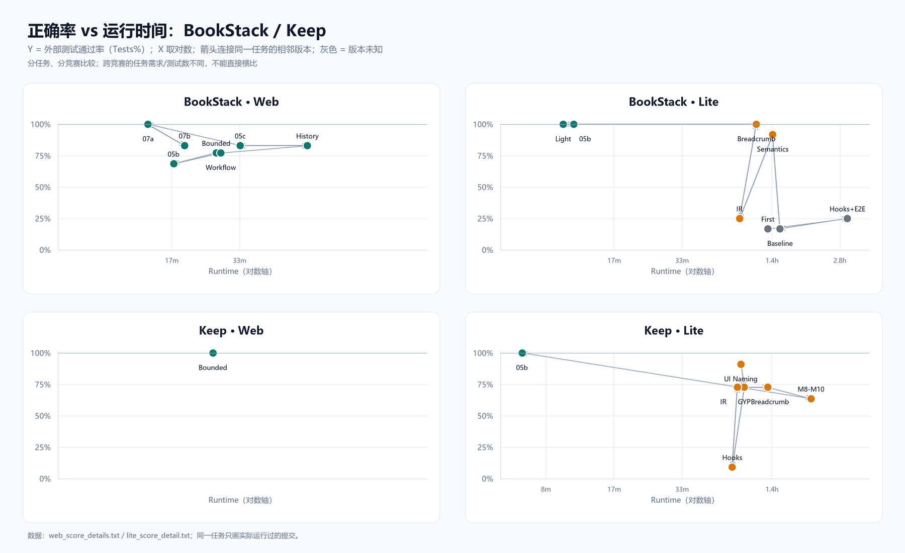
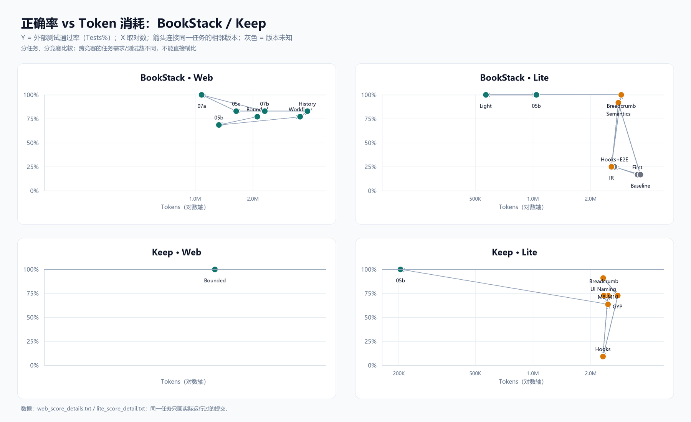
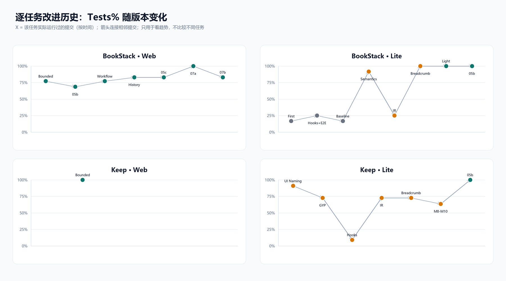
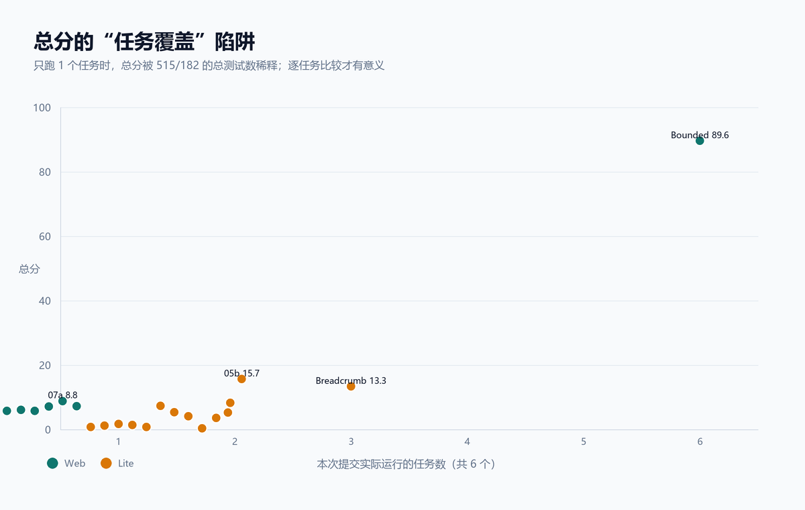

# 提交数据与版本分析（中期报告用）

> 数据源：
> - `output/web_score_details.txt`、`output/lite_score_detail.txt`（手动粘贴的提交详情，21 条非零提交、6 个任务）；
> - `output/ArcBench_web_scores.html`、`output/ArcBench_lite_scores.html`（提交历史与总分）；
> - `output/*.zip`（18 个已提交包）与包内 `agent-release.json`。
>
> 解析/画图：`midterm-pre/parse_details.py`、`midterm-pre/analyze_submissions.py`、
> `midterm-pre/draw_task_charts.py`。
>
> 核心结论：**总分不能直接比较**——它受"这次跑了几个任务"影响很大；有意义的是**同一竞赛、同一任务**的
> Tests%（通过率）与 Runtime/Tokens 的对比。

---

## 0. 核心发现

1. **总分被任务覆盖稀释**：Web 的 Bounded 跑满 6 个任务，总分 89.59；后续 Web 提交大多只跑 BookStack
   一个任务，即使 BookStack Tests% 到 100%，总分也只有 5–9。因此 PPT 必须**分 Web/Lite、逐任务**讲。
2. **BookStack 是唯一同时有 Web 和 Lite 长历史的样本**：
   - Web：77.1% → 100%（07a，13m6s，1.081M tokens，task score 130.10）；
   - Lite：16.7% → 91.7%（Semantics）→ 100%（Breadcrumb / Light / 05b），
     Light 用 9m56s、0.568M tokens 达到 100%。
3. **Keep 的 Lite 历史完整**：UI Naming 90.9% → Hooks 9.1% → IR/GYP/Breadcrumb 72.7% →
   **M8-M10 63.6%（7/11）** → 05b **100% / 6m32s / 0.204M**。
4. **M8-M10 是明确的负向点**：Keep 只跑一个任务，Tests% 63.6%、2h4m、2.459M，比 Breadcrumb 更慢更低；
   根因是 REQ-2.4 设计 502 空覆盖 + 导航名 "Sidebar navigation" 回归（见 §6）。
5. **资源效率最佳点**：
   - BookStack Web：07a（100%、13m6s、1.081M、130.10）；
   - BookStack Lite：Light（100%、9m56s、0.568M、125.80）；
   - Keep：05b（100%、6m32s、0.204M、127.41）；
   - 05b 的 BookStack 也保持 100%，但比 Light 多约 1 分钟/0.47M tokens。
6. **其他任务历史很稀疏**：StackOverflow 只有 Bounded（Web）和 Breadcrumb（Lite）两个点；
   12306 只有 Bounded + Nowic×2；Ctrip/PrestaShop 只有 Bounded 的 Web 全量运行。
   这些任务暂时无法画"版本迭代趋势"，只能作为单点参考。

---

## 1. 口径与数据说明

### 1.1 平台输出字段

每个提交（Detail 页）现在能拿到：

- 总分、Test pass rate（通过数/总数）、Model cost、Total runtime、Tokens；
- 6 个任务各自：是否运行（Open run / Not run）、Task score、Tests%、Features%、Runtime、Tokens、Cost。

Web 总测试数 **515**；Lite 总测试数 **182**。`Not run` 的任务按 0 分计；没有出现在 Detail 里的任务同样视为未跑。

### 1.2 总分的解释

- 平台分数综合通过率、token 消耗和时间消耗；**单任务耗时/token 特别少时，task score 可以超过 100**
  （例：07a BookStack 130.10、05b Keep 127.41）。
- 总分按提交实际运行的任务汇总；只跑 1–2 个任务时，分母仍是 515/182，所以总分明显低。
- 因此：
  - **不要**用总分比较"只跑 BookStack"和"跑满 6 个任务"的提交；
  - 正确做法是**固定竞赛 + 固定任务**，比较 Tests% 和 Runtime/Tokens。

### 1.3 版本与未知项

- 18 个 ZIP 与平台提交名可对应；同名 ZIP 可能同时提交到 Web 和 Lite（如 Light、05b）。
- 早期提交的 ZIP 不在 `output/`（`compiler.zip` / `baseline.zip` 或组员直接发的包），
  版本列写"未知"，但分数/运行数据保留。
- 0 分提交（Web：07d、Light 的 Web 运行、zmr×2；Lite：Fix E2E、D1、E2E Re-fixed、Nowic 11-07）按用户要求排除；
  它们没有 Detail 数据。

**版本映射（非零提交）**

| ZIP / 版本 | 平台发布版本 | 提交（竞赛/总分） |
| --- | --- | --- |
| semantics.zip | —（staged） | Lite / 7.33 |
| compiler-ui-naming-20261107.zip | —（staged） | Lite / 5.35 |
| gyp.no1.zip | —（staged） | Lite / 4.10 |
| compiler-hooks.zip | —（staged） | Lite / 0.34 |
| ir_amended.zip | —（staged） | Lite / 5.25 |
| readcrumb.zip | —（staged） | Lite / 13.35 |
| ntry_route.zip（M8/M9/M10） | —（staged） | Lite / 3.55 |
| Light 20261115 dzs.zip | 0.1.0a2 | Lite / 8.29（Web 0 排除） |
| Lite Bounded Runtime 20261115 dzs.zip | 0.1.0a4 | Web / 89.59 |
| Lite 05b Log Preview 20261116 dzs.zip | 0.1.0a5.post1 | Lite / 15.67；Web / 5.80 |
| Lite Workflow Groups 20261118 dzs.zip | 0.1.0a6 | Web / 6.09 |
| Lite History Search 20261119 dzs.zip | 0.1.0a6.post1 | Web / 5.83 |
| Lite 05c Log Labels 20261119 dzs.zip | 0.1.0a5.post2 | Web / 7.14 |
| Lite 07a Input Hints 20261120 dzs.zip | 0.1.0a7 | Web / 8.84 |
| Lite 07b Input Hints and Obligations 20261120 dzs.zip | 0.1.0a7.post1 | Web / 7.20 |
| Lite 07d Scenario Coverage 20261120 dzs.zip | 0.1.0a7.post3 | Web / 0（排除） |

> 版本号顺序与提交顺序不完全一致（例如 05c 是 a5.post2、History 是 a6.post1）；上表按提交时间叙述，
> 版本号只用于核对包。

### 1.4 注意：Overall Runtime ≠ 各任务 Runtime 之和

- 例：Semantics Enhanced 的 overall Runtime 776m51s，但唯一运行的 BookStack 任务只有 83m58s；
  说明 overall runtime 可能包含失败重试/额外探索，而 task 结果只记录最终有效运行。
- 因此**图和表统一使用 per-task Runtime / Tokens**；overall 只用于总览。

---

## 2. 提交总览（Detail 可解析的 21 条）

### 2.1 Web 全量任务（7 条非零；另有 4 条 0 分未列入）

| 日期 | 版本 | 总分 | Tests（通过/总数） | Total runtime | Tokens | 跑的任务 |
| --- | --- | ---: | --- | ---: | ---: | ---: |
| 11-15 | Bounded（0.1.0a4） | **89.59** | 74.8% · 385/515 | 600m 13s | 212.552M | 6/6 |
| 11-17 | 05b（0.1.0a5.post1） | 5.80 | 4.7% · 24/515 | 17m 2s | 1.330M | 1/6 |
| 11-18 | Workflow（0.1.0a6） | 6.09 | 5.2% · 27/515 | 27m 31s | 3.526M | 1/6 |
| 11-19 | History（0.1.0a6.post1） | 5.83 | 5.6% · 29/515 | 66m 31s | 3.841M | 1/6 |
| 11-19 | 05c（0.1.0a5.post2） | 7.14 | 5.6% · 29/515 | 33m 32s | 1.637M | 1/6 |
| 11-20 | 07a（0.1.0a7） | **8.84** | 6.8% · 35/515 | 13m 6s | 1.081M | 1/6 |
| 11-20 | 07b（0.1.0a7.post1） | 7.20 | 5.6% · 29/515 | 19m 3s | 2.304M | 1/6 |

- Bounded 是唯一跑满 6 个任务的 Web 提交，总分高是"覆盖 + 综合"的结果，不是单任务正确率最高。
- 07a 的 BookStack 已经 100%，但总分只有 8.84，因为只跑了 1/6 个任务。

### 2.2 Lite 任务（14 条非零）

| 日期 | 版本 | 总分 | Tests（通过/总数） | Total runtime | Tokens | 跑的任务 |
| --- | --- | ---: | --- | ---: | ---: | ---: |
| 11-04 | First（未知） | 0.74 | 1.1% · 2/182 | 79m 57s | 3.503M | 1/6 |
| 11-04 | Hooks+E2E（未知） | 1.25 | 1.6% · 3/182 | 179m 45s | 2.655M | 1/6 |
| 11-05 | Nowic（未知） | 1.68 | 3.3% · 6/182 | 837m 23s | 56.522M | 1/6 |
| 11-05 | Nowic（未知） | 1.38 | 2.7% · 5/182 | 825m 3s | 53.480M | 1/6 |
| 11-05 | Baseline（未知） | 0.74 | 1.1% · 2/182 | 90m 23s | 3.632M | 1/6 |
| 11-05 | Semantics | 7.33 | 10.4% · 19/182 | 776m 51s | 30.717M | 1/6 |
| 11-07 | UI Naming | 5.35 | 5.5% · 10/182 | 60m 42s | 2.324M | 1/6 |
| 11-07 | GYP | 4.10 | 4.4% · 8/182 | 62m 50s | 2.764M | 1/6 |
| 11-07 | Hooks | 0.34 | 0.5% · 1/182 | 55m 33s | 2.314M | 1/6 |
| 11-09 | IR | 5.25 | 6.0% · 11/182 | 118m 33s | 5.023M | 2/6 |
| 11-11 | Breadcrumb | **13.35** | 15.9% · 29/182 | 468m 57s | 18.828M | 3/6 |
| 11-13 | M8-M10（entry_route） | 3.55 | 3.8% · 7/182 | 124m 5s | 2.459M | 1/6 |
| 11-15 | Light（0.1.0a2） | 8.29 | 6.6% · 12/182 | 9m 56s | 0.568M | 1/6 |
| 11-17 | 05b（0.1.0a5.post1） | **15.67** | 12.6% · 23/182 | 17m 36s | 1.246M | 2/6 |

- 早期 staged 提交基本只跑一个任务；Breadcrumb 是 staged 中唯一跑 3 个任务的（BookStack/Keep/StackOverflow）。
- Light 只跑 BookStack，总分 8.29；05b 跑 BookStack+Keep，总分 15.67——总分差异主要来自覆盖，不是单任务退化。

---

## 3. 任务覆盖矩阵

| 任务 | Web 运行过的提交 | Lite 运行过的提交 |
| --- | --- | --- |
| BookStack | Bounded, 05b, Workflow, History, 05c, 07a, 07b（7） | First, Hooks+E2E, Baseline, Semantics, IR, Breadcrumb, Light, 05b（8） |
| Keep | Bounded（1） | UI Naming, GYP, Hooks, IR, Breadcrumb, M8-M10, 05b（7） |
| StackOverflow | Bounded（1） | Breadcrumb（1） |
| 12306 | Bounded（1） | Nowic ×2（2） |
| Ctrip | Bounded（1） | — |
| PrestaShop | Bounded（1） | — |

**结论**：

- 只有 **BookStack** 和 **Keep** 有足够的逐任务历史（≥7 个点）；
- StackOverflow、12306 只有 1–2 个点，只能作为单点参考；
- Ctrip/PrestaShop 只有 Bounded 的全量运行，无法谈"版本趋势"；
- 这也是为什么"总分趋势"会误导：大部分提交只覆盖 1 个任务。

---

## 4. 逐任务对比

### 4.1 BookStack

**Web（全量任务）**

| 日期 | 版本 | Tests% | Task score | Runtime | Tokens |
| --- | --- | ---: | ---: | ---: | ---: |
| 11-15 | Bounded | 77.1 | 95.57 | 26m 17s | 2.108M |
| 11-17 | 05b | 68.6 | 85.37 | 17m 2s | 1.330M |
| 11-18 | Workflow | 77.1 | 89.60 | 27m 31s | 3.526M |
| 11-19 | History | 82.9 | 85.74 | 1h 6m | 3.841M |
| 11-19 | 05c | 82.9 | 105.01 | 33m 32s | 1.637M |
| **11-20** | **07a** | **100.0** | **130.10** | **13m 6s** | **1.081M** |
| 11-20 | 07b | 82.9 | 105.90 | 19m 3s | 2.304M |

- 07a 是 Web 的 Pareto 最优点：100% + 最短 runtime + 最低 tokens + 最高 task score；
- 05c 与 07b 都是 82.9%：05c 用 33m/1.637M（时间多、token 少），07b 用 19m/2.304M
  （时间少、token 多）；task score 接近（105.01 vs 105.90），是典型的资源权衡；
- 05b 是 68.6%，是 Web 的低点；后续 05c/07a/07b 恢复到 82.9–100%。

**Lite**

| 日期 | 版本 | Tests% | Task score | Runtime | Tokens |
| --- | --- | ---: | ---: | ---: | ---: |
| 11-04 | First（未知） | 16.7 | 11.20 | 1h 19m | 3.503M |
| 11-05 | Hooks+E2E（未知） | 25.0 | 19.01 | 2h 59m | 2.655M |
| 11-05 | Baseline（未知） | 16.7 | 11.30 | 1h 30m | 3.632M |
| 11-05 | Semantics | **91.7** | 89.44 | 1h 23m | 2.786M |
| 11-09 | IR | 25.0 | 19.15 | 59m 57s | 2.564M |
| 11-11 | Breadcrumb | **100.0** | 100.14 | 1h 11m | 2.883M |
| 11-15 | Light | **100.0** | **125.80** | **9m 56s** | **0.568M** |
| 11-17 | 05b | **100.0** | 121.62 | 11m 4s | 1.042M |

- Semantics 第一次把 BookStack 从 16.7%/25% 推到 91.7%；
- IR 回落到 25%，是一个需要单独检查的回归样本；
- Breadcrumb 达到 100%，但 runtime 1h11m、tokens 2.883M；
- Light 把同样 100% 压到 9m56s / 0.568M，task score 125.80；
- 05b 同样 100%，但 11m4s / 1.042M，task score 121.62，略低于 Light。

**BookStack 结论**：

- Web 最佳：07a（100%，13m，1.081M，130.10）；
- Lite 最佳：Light（100%，9m56s，0.568M，125.80）；
- 05b 与 Light 都是 100%，但 Light 更省资源；05b 的额外价值是同时跑了 Keep（见 4.2）。

### 4.2 Keep

**Web**：只有 Bounded：100%、124.10、25m25s、1.267M。

**Lite**

| 日期 | 版本 | Tests% | Task score | Runtime | Tokens |
| --- | --- | ---: | ---: | ---: | ---: |
| 11-07 | UI Naming | 90.9 | 88.52 | 1h 0m | 2.324M |
| 11-07 | GYP | 72.7 | 67.89 | 1h 2m | 2.764M |
| 11-07 | Hooks | 9.1 | 5.63 | 55m 33s | 2.314M |
| 11-09 | IR | 72.7 | 68.45 | 58m 36s | 2.459M |
| 11-11 | Breadcrumb | 72.7 | 68.09 | 1h 19m | 2.339M |
| 11-13 | M8-M10 | **63.6** | 58.73 | 2h 4m | 2.459M |
| **11-17** | **05b** | **100.0** | **127.41** | **6m 32s** | **0.204M** |

- UI Naming 已经到 90.9%，但 Hooks 掉到 9.1%（一次异常回退）；
- IR/GYP/Breadcrumb 在 72.7% 平台期；
- M8-M10 进一步降到 63.6%，且 runtime 2h4m，是"更慢更差"的明确负向点；
- 05b 用 6m32s、0.204M 达到 100%，task score 127.41，是 Keep 的 Pareto 最优点。

### 4.3 StackOverflow、12306、Ctrip、PrestaShop

| 任务 | 竞赛 | 版本 | Tests% | Task score | Runtime | Tokens |
| --- | --- | --- | ---: | ---: | ---: | ---: |
| StackOverflow | Web | Bounded | 88.1 | 105.86 | 1h 20m | 26.388M |
| StackOverflow | Lite | Breadcrumb | 32.1 | 23.08 | 5h 17m | 13.606M |
| 12306 | Web | Bounded | 59.2 | 71.10 | 1h 53m | 43.779M |
| 12306 | Lite | Nowic（未知） | 12.2 | 6.25 | 13h 57m | 56.522M |
| 12306 | Lite | Nowic（未知） | 10.2 | 5.14 | 13h 45m | 53.480M |
| Ctrip | Web | Bounded | 78.3 | 91.29 | 4h 0m | 121.058M |
| PrestaShop | Web | Bounded | 73.3 | 90.35 | 1h 53m | 17.953M |

- StackOverflow 是 Web/Lite 差异最大的任务：Bounded 88.1%（但 26.4M tokens），Breadcrumb Lite 32.1%
  （5h17m、13.6M）——Lite 需求更少，仍只过 32.1%，是后续重点。
- 12306 的 Lite Nowic 跑了近 14 小时/56M tokens，仅 10–12%，是"高成本低正确率"的极端点。
- Ctrip 4h/121M tokens 是资源消耗最大的单任务；PrestaShop 73.3%。

---

## 5. 正确率 vs 成本

### 5.1 Pareto 最优点

| 任务 | 最优点 | Tests% | Runtime | Tokens | Task score |
| --- | --- | ---: | ---: | ---: | ---: |
| BookStack（Web） | 07a | 100.0 | 13m 6s | 1.081M | 130.10 |
| BookStack（Lite） | Light | 100.0 | 9m 56s | 0.568M | 125.80 |
| Keep（Lite） | 05b | 100.0 | 6m 32s | 0.204M | 127.41 |
| Keep（Web） | Bounded | 100.0 | 25m 25s | 1.267M | 124.10 |

### 5.2 资源效率对比

- **BookStack**：
  - 07a vs Bounded：100% vs 77.1%，runtime 13m vs 26m，tokens 1.08M vs 2.11M——正确率和成本同时更优；
  - 07a vs 05c：100% vs 82.9%，runtime 13m vs 33m，tokens 1.08M vs 1.64M；
  - 07a vs 07b：100% vs 82.9%，runtime 13m vs 19m，tokens 1.08M vs 2.30M。
- **Keep**：
  - 05b vs UI Naming：100% vs 90.9%，runtime 6m32 vs 60m，tokens 0.204M vs 2.324M；
  - 05b vs Breadcrumb：100% vs 72.7%，runtime 6m32 vs 1h19m，tokens 0.204M vs 2.339M；
  - M8-M10：63.6%、2h4m、2.459M，正确率和成本都劣于前代。
- **总分 vs task score**：
  - 07a 的 task score 130.10，但总分 8.84（只跑 1/6）；
  - Bounded 的 task score 95.57，总分 89.59（跑满 6/6）；
  - 这再次说明不能用总分比较不同覆盖度的提交。

### 5.3 结论

1. 单任务看，**07a（BookStack Web）和 05b（Keep Lite）是当前最好的两个点**；
2. Light 在 BookStack Lite 上资源最优，但只跑一个任务，总分不体现；
3. M8-M10 是"正确率下降 + 成本上升"的双输点，必须复盘（§6）；
4. StackOverflow/12306 是下一阶段的高成本风险点，尤其 12306 的 Lite Nowic（~14h、56M tokens、10–12%）。

---

## 6. M8-M10 Keep 复盘（外部 7/11）

产物：`output/M8-M10_keep/template/`；平台 Detail：Keep 任务 **63.6%**（7/11）、runtime **2h4m**、
tokens **2.459M**、task score 58.73。对比 Breadcrumb（72.7%、1h19m、2.339M）和 UI Naming
（90.9%、1h0m、2.324M），M8-M10 同时更慢、更差。

失败：REQ-1.1 一条 + REQ-2.4 三条，全部是超时。

### 6.1 根因 A：REQ-2.4 设计调用 502，整条需求空覆盖

- `compiler.log`：REQ-2.4 的 UI 设计调用 `ef4bd769` 在 **541.41 s** 后返回
  `502 Upstream connection, response size or timeout error`；
- 任务被标 `FAILED; continuing`，`ui_design.json` 中 `REQ-2.4 -> []`，三个步骤也为空；
- `frontend_e2e.json`：`REQ-2.4 = NO_TRIGGERS`，summary 只有 5 个 requirement；
- 阶段 09/12 均为 `COMPLETED_WITH_FAILURES`。

机制：

1. `propose_json` 只重试"响应读不懂/校验失败"，**不重试 502/超时**；
2. `TaskFailures.finish()` 在阶段末尾 `raise StageIncomplete`，而 `repair_semantics`、最终 normalize
   在它之后——本轮**没有跑语义修复**；
3. 阶段 11 没有 REQ-2.4 的 trigger，阶段 12 不实现 Archive/Undo/Unarchive/status；
   外部 helper 等不到元素，只能耗尽用例时限。

### 6.2 根因 B：导航名 "Sidebar navigation" vs "Sidebar"

- 需求写 "a visible Sidebar navigation"，外部期望 `getByRole('navigation', { name: 'Sidebar' })`；
- 设计把名字写成 "Sidebar navigation"（M9 提示词"逐字保留 + Main navigation 例子"的过度泛化）；
- 如果 `repair_semantics` 跑了，M9 契约检查会报 `UI-app-sidebar` 名字不符；
  但根因 A 让阶段提前退出，修复没执行。
- 额外 bug：`Undo` 因为存在别的 `{var}` 按钮，被模板容错误跳过（静态名不该被跳过）。

### 6.3 修复建议

| # | 修复 | 目的 |
| --- | --- | --- |
| 1 | 对 502/503/504/timeout 重试 1–2 次再标 FAILED | 避免一次上游抖动毁掉整条需求 |
| 2 | `synthesize_ui` 在 `StageIncomplete` 时仍先跑 `repair_semantics`/finalize | 失败阶段也能修已成功部分 |
| 3 | leaf requirement 的 elements 为空 → 阶段失败/阻止提交 | 不允许空需求进入实现 |
| 4 | M9 提示词：`<X> navigation` 中 X 是名字；只有 Main/Primary 等限定词才并入 navigation | 保持 Sidebar vs Main navigation 的区分 |
| 5 | 模板容错只跳过真正含 `{var}` 的名字；静态名必须检查 | 让 Undo/Archive 缺失被发现 |
| 6 | M10 preflight 接入提交前流程，关键控件缺失升级为 failure | 提交前拦住导航/控件问题 |

---

## 7. 图表（样图）

> 数据：21 条非零提交、实际运行过的任务；所有点都画上，灰色 = 版本未知；X 取对数；
> 箭头连接同一任务/竞赛的相邻提交。样图只标注关键版本，完整数据见上表；后续按视觉效果删点。

### 7.1 正确率 vs 运行时间



- 左上 BookStack Web：07a 在右上（100%、13m），Bounded 在左（77%、26m）；
- 右上 BookStack Lite：Light/05b 在 100% 且 10–11m；Semantics 91.7% 但 1h23m；
- 左下 Keep Web：只有 Bounded（100%、25m）；
- 右下 Keep Lite：05b 在左上（100%、6m32s）；Hooks 在下方（9.1%）；M8-M10 在右侧（63.6%、2h4m）。

### 7.2 正确率 vs Token 消耗



- 07a（BookStack Web）1.081M tokens、100%；05b（Keep）0.204M tokens、100%；
- M8-M10（Keep）2.459M tokens、63.6%；
- 05b 的 BookStack 1.042M、100%，略高于 Light 的 0.568M。

### 7.3 逐任务 Tests% 趋势（辅助）



- 适合讲"改进历史"：BookStack Web 77.1→68.6→77.1→82.9→82.9→100→82.9；
  Keep Lite 90.9→72.7→9.1→72.7→72.7→63.6→100；
- 注意 BookStack Lite 的 Semantics 91.7 与 IR 25 的波动，说明单点结果受实现/测试生成影响，不能只看相邻一两个点。

### 7.4 总分 vs 任务覆盖（辅助解释）



- Bounded 跑满 6 个任务，总分 89.59；大部分提交只跑 1 个任务，总分 5–9；
- 这张图用于解释"为什么总分不能直接比"，不作为正确率结论。

### 7.5 最终 PPT 选图建议

- 主图：`tests_vs_runtime.png`（或 `tests_vs_tokens.png` 二者选一；Runtime 更直观，Tokens 作为备份）；
- 辅图：`task_tests_trend.png` 讲版本迭代；
- 如果版面有限，只保留 BookStack 和 Keep 两个任务、Web/Lite 各一列，删掉单点面板（如 Keep Web）
  与其他稀疏任务；这正是"最后按视觉效果删点"的方向。

---

## 8. 复现

```powershell
# 1) 提交历史 + ZIP 版本映射
uv run python midterm-pre/analyze_submissions.py

# 2) 解析 Detail 文本（21 条非零提交 + 6 任务）
uv run python midterm-pre/parse_details.py

# 3) 生成四张图
uv run python midterm-pre/draw_task_charts.py
```

注意：

- `parse_details.py` 以"日期行"切分提交；任务段以 6 个固定任务名定位，`Not run` 不计入；
- `ArcBench_*_scores.html` 的历史列表要按 `<li class="competition-history-item` 前缀切分，
  否则会漏掉 leaderboard 的 `is-selected` 条目（Bounded/05b）；
- 同一个 ZIP 可能提交到 Web 和 Lite，分数不可跨竞赛比较。

---

## 9. 数据风险与待确认

1. **Detail 是手动粘贴的**：提交名/日期可能与历史页有细微差异（例如 Web 的 05b 与 Lite 的
   "Lite Log Preview" 实际是同一个 ZIP），本文件按 ZIP/名称已做映射；
2. **Overall Runtime 含重试**：Semantics 的 overall 776m 与单任务 84m 不一致；图表统一用 per-task；
3. **未知版本**：`compiler.zip` / `baseline.zip` 不在 `output/`，版本列留空，但数据和点保留；
4. **任务集可能变化**：Web 515 测试、Lite 182 测试；不同日期任务需求可能增删，跨大版本比较要谨慎；
5. 若需要更精确的"正确率"定义（Tests% vs Features%），以 Tests% 为准；Features% 只作参考。
